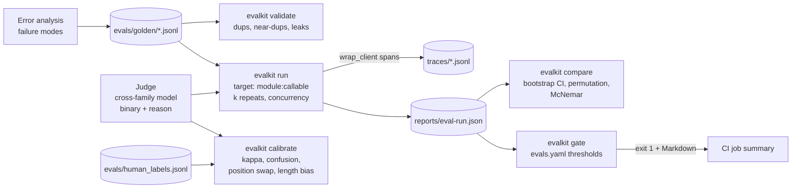

# llm-evalops

**Catch LLM regressions before merge, and know what every request costs after.**

One Python distribution, two packages, two CLIs:

| Package | What it is | CLI |
|---|---|---|
| `evalkit` | Golden sets from error analysis, a calibrated cross-family LLM judge, paired A/B statistics, and a CI gate that fails the build on regression | `evalkit validate / run / calibrate / compare / gate / annotate` |
| `llmops` | Tracing (JSONL + OpenTelemetry GenAI attributes), cost attribution and bill reconciliation, latency percentiles, exact + semantic caching, alert rules with drift tests, a Streamlit dashboard | `llmops cost / latency / cache-stats / check / alert-stats / before-after / dashboard` |

Everything in this README was produced by scripts in this repo (`make demo`, `make synth`,
`make bench`) with `LLM_PROVIDER=fake`. The fake provider is deterministic, so the numbers
demonstrate the **pipeline**, not model quality; they are labeled `fake-provider` / `synthetic`
wherever they appear. The real backends (`openrouter` by default, plus direct `anthropic` and
`openai`) are implemented and exercised only when a key is present.

---

## Headline 1: the regression the gate caught

`make demo` builds a 36-case RAG golden set, runs a baseline target and a deliberately regressed
candidate (shallower retrieval + a prompt change that invites unsupported elaboration), then gates
the candidate against `evals.yaml`. The gate exits 1 and prints this table (`reports/gate-rag.md`):

**GATE FAILED (2 violation(s))** — baseline `rag-baseline` -> candidate `rag-candidate`

| Metric | Baseline | Candidate | Δ | Threshold | Status |
|---|---|---|---|---|---|
| cases | 36.000 | 36.000 | +0.000 | min_cases 10 | PASS |
| faithfulness | 1.000 | 0.714 | -0.286 | min 0.85, max_drop 0.05 | FAIL — 0.714 < min 0.85; dropped 0.286 > max_drop 0.05 |
| recall_at_5 | 1.000 | 1.000 | +0.000 | min 0.8, max_drop 0.05 | PASS |
| answer_relevance | 0.944 | 0.944 | +0.000 | min 0.8, max_drop 0.1 | PASS |
| exact_match | 0.861 | 0.667 | -0.194 | max_drop 0.1 | FAIL — dropped 0.194 > max_drop 0.1 |
| cost_usd_per_case | 0.001 | 0.001 | -0.000 | max_increase 0.002 | PASS |

The agent half of the demo shows why reliability needs `pass^k`, not `pass@k`: a tool-loop bug
that only sometimes fires barely moves single-run success but collapses pass^3
(`reports/gate-agent.md`):

| Metric | Baseline | Candidate | Δ | Threshold | Status |
|---|---|---|---|---|---|
| task_success | 0.917 | 0.556 | -0.361 | min 0.8, max_drop 0.1 | FAIL |
| pass_pow_k | 0.917 | 0.083 | -0.833 | min 0.8, max_drop 0.1 | FAIL |

And `evalkit compare` says whether the drop is noise (`reports/compare-rag.md`, 36 paired cases,
10 000 bootstrap resamples):

| Metric | n | A | B | Δ (B−A) | 95% CI | p (perm) | p (McNemar) | Verdict |
|---|---|---|---|---|---|---|---|---|
| exact_match | 36 | 0.861 | 0.667 | -0.194 | [-0.333, -0.083] | 0.015 | 0.016 | B worse |
| f1_token | 36 | 0.864 | 0.770 | -0.094 | [-0.161, -0.038] | 0.008 | n/a | B worse |
| faithfulness | 35 | 1.000 | 0.714 | -0.286 | [-0.429, -0.143] | 0.001 | 0.002 | B worse |
| recall_at_5 | 33 | 1.000 | 1.000 | +0.000 | [+0.000, +0.000] | 1.000 | n/a | no significant difference |
| answer_relevance | 36 | 0.944 | 0.944 | +0.000 | [+0.000, +0.000] | 1.000 | 1.000 | no significant difference |

## Headline 2: what serving changes did to cost and latency

`make synth` generates four **synthetic, seeded** trace sets for the same request stream
(`scripts/synth_traces.py`) and `llmops dashboard --compare` renders the before/after view.
`reports/before_after.md`:

| Scenario | requests | $/1k req | Δ cost | p50 ms | p95 ms | Δ p95 | cache hit rate | error rate |
|---|---|---|---|---|---|---|---|---|
| baseline | 3000 | 11.84 | +0% | 2977 | 5675 | +0% | 0% | 1.7% |
| exact_cache | 3000 | 9.48 | -20% | 2569 | 5278 | -7% | 21% | 1.3% |
| semantic_cache | 3000 | 8.02 | -32% | 2145 | 5157 | -9% | 35% | 0.9% |
| cheaper_model | 3000 | 5.45 | -54% | 2179 | 5208 | -8% | 34% | 0.5% |

The baseline set carries an incident in its last hour; `llmops check` catches it
(`reports/alerts.md`):

| Rule | Type | Baseline | Window | Δ | Threshold | Status |
|---|---|---|---|---|---|---|
| cost-per-request-spike | cost_spike | 0.01156 (980) | 0.02824 (54) | +0.01668 | +50% | VIOLATION — +144.3% > 50% |
| p95-latency-regression | p95_regression | 5473 (980) | 7541 (54) | +2068 | +30% | VIOLATION — +37.8% > 30% |
| error-rate-jump | error_rate_jump | 0.01429 (980) | 0.1111 (54) | +0.09683 | +0.02 abs | VIOLATION — +0.09683 > 0.02 |
| output-length-drift | output_length_drift | 192 (1410) | 186 (72) | -6 | KS p < 0.01 and median shift > 10% | OK — KS stat 0.106, p=0.401 |
| refusal-rate-drift | refusal_rate_drift | 0.01915 (1410) | 0.04167 (72) | +0.02252 | +0.05 abs | OK — +117.6% |

### The same view over real `docs-rag` traces (fake provider, projected cost)

The table above is generated. This one is not: `docs-rag`'s `scripts/trace_scenarios.py` replays
its 222-question golden set through the actual RAG pipeline (retrieve, rerank, generate, cite)
under four configurations, all serving the **same 666-request stream** (the questions, the same
questions again, then lightly reworded versions), and writes each run's spans, through
`llmops.tracing`, to `docs-rag/traces/scenarios/<scenario>/`. `llmops before-after` builds the
table (`make real-before-after`, or `llmops before-after --dirs '../docs-rag/traces/scenarios/*'`):

| Scenario | requests | $/1k req | Δ cost | p50 ms | p95 ms | Δ p95 | cache hit rate | error rate |
|---|---|---|---|---|---|---|---|---|
| baseline | 666 | 5.60 | +0% | 9 | 15 | +0% | 0% | 0.0% |
| exact_cache | 666 | 3.71 | -34% | 10 | 16 | +5% | 34% | 0.0% |
| semantic_cache | 666 | 2.47 | -56% | 3 | 18 | +17% | 56% | 0.0% |
| cheaper_model | 666 | 1.41 | -75% | 3 | 18 | +20% | 56% | 0.0% |

**Label: fake provider, projected cost.** The retrieval, reranking, caching and tracing code is
real; the LLM is the deterministic fake, which has no latency and no bill. So `$/1k req` is
*projected* (the observed token counts priced at list price: `anthropic/claude-sonnet-4.5`,
`anthropic/claude-haiku-4.5` for `cheaper_model`, reranker billed as `rerank-v3.5`), and
`p50/p95` are pipeline compute only. With a zero-latency LLM a cache lookup can only add time to a
miss, which is why p95 *rises* here; against a real model a hit saves seconds. Hit rates are set by
the replay design (a third of the stream is verbatim repeats), not by real traffic. The semantic
layer is `llmops.cache.SemanticCache` with the offline hashed bag-of-words embedder at threshold
0.92: it served 147 of the 222 rewordings (no cross-question false hit in the 222 originals), and
the script's audit found 8 of those 147 answers differing from the uncached pipeline's answer
for the same reworded question, which is the correctness risk this layer buys its savings with.
The synthetic table keeps CI independent of the sibling repo; this one needs `docs-rag` next to
this repo (`make -C ../docs-rag traces`).

---

## Architecture

### evalkit



### llmops

```mermaid
flowchart LR
    APP[Your app] -->|wrap_client / span()| TR[Tracer]
    TR --> JS[(JSONL sink<br/>TRACE_PATH)]
    TR -.optional.-> OT[OTel exporter<br/>gen_ai.* attributes]
    PR[(pricing.json)] --> TR
    APP --> CC[CachedClient<br/>exact LRU/Redis -> semantic]
    CC --> TR
    JS --> COST[llmops cost<br/>by request/feature/user/model/day<br/>--validate-against bill.csv]
    JS --> LAT[llmops latency<br/>p50/p95/p99, TTFT, stages]
    JS --> CS[llmops cache-stats]
    JS --> CHK[llmops check<br/>alerts.yaml rules, KS drift]
    CHK --> N[stdout / Slack / email]
    CHK --> OUT[(alerts/outcomes.jsonl<br/>false-alarm rate)]
    JS --> DASH[llmops dashboard<br/>Streamlit, before/after]
```

## Quickstart

```bash
uv sync --all-extras            # Python 3.12, pinned via .python-version
cp .env.example .env            # LLM_PROVIDER=fake works with no keys
make test                       # 89 tests
make demo                       # golden set -> runs -> calibrate -> compare -> gate (fails on purpose)
make synth                      # synthetic traces + reports/before_after.md
make real-before-after          # same table from ../docs-rag/traces/scenarios (run `make traces` there first)
make dashboard                  # http://localhost:8501
make bench                      # reports/overhead.md
```

Without `make` (Windows): run the same `uv run ...` commands from the `Makefile`.

With a real provider: set `OPENROUTER_API_KEY` (OpenRouter is the default real backend; model ids
are OpenRouter slugs such as `anthropic/claude-sonnet-4.5`), or `ANTHROPIC_API_KEY` /
`OPENAI_API_KEY` for the direct backends. `get_client()` picks `openrouter` > `anthropic` >
`openai` > `fake` by which key exists, unless `LLM_PROVIDER` says otherwise.

## Integrate in another repo in five lines

```python
from llmops.tracing import wrap_client  # 1. every LLM call becomes a costed span

client = wrap_client(get_client(), feature="rag.answer")
```

```bash
uv add ../llm-evalops                                              # 2. depend on it
uv run evalkit run --golden evals/golden/rag.jsonl --target my_pkg.eval:answer \
   --metrics recall_at_20,faithfulness,task_success --out reports --run-id pr      # 3. score the PR
uv run evalkit gate --baseline reports/eval-main.json --candidate reports/eval-pr.json \
   --config evals.yaml --md reports/gate.md --annotate                              # 4. fail CI on regression
uv run llmops check --traces traces/ --rules alerts.yaml --window 1h --baseline-window 24h --notify  # 5. watch prod
```

`docs/integration.md` is the wiring guide; `docs-rag` and `briefing-agent` already follow it
(their local `tracing.py` / `pricing.py` / `gate.py` are gone). `ci/action.yml` (composite action) and `ci/eval-gate.yml` (reusable
workflow) wrap steps 3 and 4.

---

## evalkit in detail

### Golden sets

`evals/golden/*.jsonl`, one case per line:
`{"id","input":{...},"expected":{...},"failure_mode","tags":[...],"source":"error_analysis|synthetic|human"}`.
`evalkit validate` rejects schema errors, duplicate ids and duplicate inputs, and warns on
near-duplicates (normalized token Jaccard > 0.9) and leaky cases (an expected string of 12+
characters appearing verbatim in the input); `--strict` turns warnings into failures.

### Metric definitions

`evalkit metrics` prints the registry. Field conventions: `output.answer`, `output.retrieved`
(ranked ids), `output.contexts`, `output.fields`; `expected.answer`, `expected.relevant`,
`expected.fields`. `None` means "not applicable to this case" and is excluded from aggregates.

| Metric | Kind | Definition |
|---|---|---|
| `exact_match` | bool | `normalize(answer) == normalize(expected.answer)`; SQuAD normalization (lowercase, strip punctuation and articles, collapse whitespace) |
| `f1_token` | score | SQuAD token F1 between normalized answers (multiset overlap) |
| `recall_at_k` | score | `|relevant ∩ retrieved[:k]| / |relevant|`; `recall_at_20` resolves to k=20 |
| `precision_at_k` | score | `|relevant ∩ retrieved[:k]| / k` (denominator is k, not the number returned) |
| `mrr` | score | `1 / rank` of the first relevant id over the full ranked list, 0 if absent |
| `ndcg_at_k` | score | binary nDCG@k: `Σ rel_i / log2(i+1)` normalized by the ideal DCG |
| `faithfulness` | bool, judge | every claim in the answer is supported by `output.contexts` |
| `answer_relevance` | bool, judge | the answer addresses the question (correctness ignored) |
| `context_precision` | score, judge | fraction of `output.contexts` judged relevant to the question (one judge call per context) |
| `task_success` | bool | verifier callable `(case, output) -> bool`; default: `output.success` if present else exact match |
| `pass_pow_k` | bool | **pass^k**: all k runs of the case succeed. Not pass@k (any of k) |
| `field_accuracy` | score | fraction of `expected.fields` keys whose normalized value matches `output.fields` (lists as sets, numbers with tolerance) |

The runner also records `latency_ms_mean`, `latency_p95_ms`, `cost_usd_per_case` and
`error_rate`, so a gate can bound cost and latency too (`max`, `max_increase`).

Add your own with `@metric("name")` in your package; the registry is global.

### Judge calibration method and bias checks

`Judge(criterion, client)` renders `src/evalkit/judge/prompts/<criterion>.txt`, asks for exactly
`{"pass": bool, "reason": str}`, parses strictly, and sends one repair turn on malformed output.
`evalkit calibrate --labels evals/human_labels.jsonl --criterion faithfulness` reports, for the
demo labels (fake judge, so take the values as a format demo):

| Check | Value | Meaning |
|---|---|---|
| Cohen's kappa | 0.864 | agreement beyond chance, from the confusion matrix; gate on judge-backed metrics only when kappa >= 0.6 |
| Agreement | 93.9% | raw accuracy against human labels |
| Confusion matrix | TP 21, FN 0, FP 2, TN 10 | human label is the truth |
| Position-swap consistency | 100% (6 pairs) | pairwise items judged in both orders must pick the same underlying output |
| Length bias r (judge vs human) | 0.765 vs 0.702 | Pearson r between output length and PASS; a gap > 0.2 means the judge rewards verbosity |

Kappa is implemented in `evalkit/judge/calibrate.py` and verified in tests against worked
examples (e.g. the 20/5/10/15 table gives 0.40). The judge model family is parsed from the model
id (OpenRouter vendor prefix or `claude-*` / `gpt-*` heuristics); `--strict-family` fails when it
equals the generator's family.

### Statistics method

`evalkit compare --a a.json --b b.json` pairs cases by id and reports, per metric: the mean
delta; a 95% percentile CI from 10 000 paired bootstrap resamples (seeded, vectorized with numpy);
a two-sided paired sign-flip permutation p-value (+1 smoothing); and, for boolean metrics,
McNemar's exact test on discordant pairs (`scipy.stats.binomtest`). A difference is called
significant when the CI excludes zero.

### Gate

`evalkit gate --baseline main.json --candidate pr.json --config evals.yaml [--md out.md] [--annotate]`
applies `min` / `max_drop` (higher-is-better) and `max` / `max_increase` (lower-is-better) per
metric plus `min_cases`, prints `| Metric | Baseline | Candidate | Δ | Threshold | Status |`,
exits 1 on any violation, and appends the table to `$GITHUB_STEP_SUMMARY` when present.
A metric marked `optional: true` (for example `recovery_rate`, which only exists in runs with
fault injection) is reported as `SKIP` instead of failing when the candidate did not measure it,
and is still checked when it did. Metrics a report stores as `null` are read as "not measured".
`evalkit annotate --md file.md` does the same for any Markdown file.

---

## llmops in detail

### Tracing

`Tracer.span(name, kind, **attrs)` nests via contextvars (`trace_id`, `parent_span_id`),
`trace(feature=, user_id=, session_id=)` scopes a request, and the JSONL sink appends one line per
span under a thread lock and a cross-process file lock. `wrap_client(client)` turns every
`complete()` into an `llm` span with model, tokens, latency and cost. Cost is the
provider-reported figure when available (OpenRouter `usage.cost`, requested via
`usage: {include: true}`), otherwise tokens × `pricing.json`; both are kept in `meta`
(`cost_source`, `cost_computed_usd`, `cost_reported_usd`). The optional OTel exporter emits spans
with GenAI semantic-convention attribute names (`gen_ai.system`, `gen_ai.request.model`,
`gen_ai.usage.input_tokens`, `gen_ai.usage.output_tokens`, `gen_ai.operation.name`,
`gen_ai.response.finish_reasons`).

`src/llmops/pricing.json` holds public list prices (USD per 1M tokens; per search for rerank)
keyed by OpenRouter slug and bare id, with lookup that strips the vendor prefix, normalizes
dots/dashes and matches dated ids. **Verify prices against the provider pages before relying on
them**; override with `PRICING_PATH`.

### Cost attribution and bill reconciliation

`llmops cost --traces traces/*.jsonl --by request|feature|user|model|day` sums `cost_usd` per
group and counts distinct traces as requests ($/1k requests is the unit the before/after table
uses). `--validate-against bill.csv` compares computed cost per (day, model) with a provider
export. Two formats are auto-detected: the simple daily format
`date,model,input_tokens,output_tokens,cost_usd` (`examples/bill_sample.csv`) and an OpenRouter
activity export with columns `created_at, model, tokens_prompt, tokens_completion, cost_total`
(`examples/openrouter_activity_sample.csv`; extra columns ignored). On the synthetic baseline the
simulated bill differs by **-1.77%** (the generator injects a 1.8% rounding drift) and the report
shows it per day and model. Only `llm` spans are reconciled by default; rerank and embedding
vendors bill separately.

### Latency

`llmops latency --by feature` gives p50/p90/p95/p99 of root-span latency; `--by stage` does the
same per span kind with each stage's share of request time, and both report TTFT percentiles
when llm spans carry `meta.ttft_ms`. On the synthetic baseline the llm stage is 95.7% of request
time, retrieval 1.2%, rerank 0.9%.

### Cache strategy

`CachedClient(client, exact=ExactCache(...), semantic=SemanticCache(...))` checks an exact cache
keyed on the full request (messages, model, tools, temperature, max_tokens; in-memory LRU or
Redis via `REDIS_URL`), then a semantic cache (cosine over embeddings of system + last user
message, scoped by model and tool usage), then calls the traced provider. Every lookup emits a
`cache` span with `cache_hit`, and hits record `saved_cost_usd` / `saved_ms` from the original
call, so `llmops cache-stats` can report hit rate and estimated savings (`exact 20.5%`,
`semantic 16.8%`, 33.9% of requests served from a cache on the synthetic semantic scenario).

Correctness risks of semantic caching, by design not hidden: a near-duplicate prompt can differ
in exactly the token that matters ("2024" vs "2025", a negation, a user id), so the threshold
(`SEMANTIC_CACHE_THRESHOLD`, default 0.92) must be tuned per feature against labeled pairs; the
cache is never consulted for tool-using calls; and the `similarity` recorded on each hit lets you
audit false hits. The offline embedder is a hashed bag-of-words, good enough to test the
mechanism, not a real embedding.

### Alert rules and false-alarm tracking

`llmops check --traces traces/ --rules alerts.yaml --window 1h --baseline-window 24h` compares
the last hour with the 24 hours before it: mean cost per request (`cost_spike`), p95 of request
latency (`p95_regression`), error rate (`error_rate_jump`), output-token distribution drift via a
two-sample Kolmogorov-Smirnov test that must also move the median by more than
`min_shift_pct` (`output_length_drift`), and refusal share from `meta.refusal` or regexes over
`meta.output_text` (`refusal_rate_drift`). Rules skip when either window has fewer than
`min_samples`. Violations go to stdout, a Slack webhook, or SMTP email (`--notify`), and the job
exits 1. `ci/alerts-schedule.yml` shows the hourly GitHub Actions schedule and the crontab line.

False alarms are tracked: `llmops check --record-outcome true|false [--alert-id ID]` labels the
violations of the last check in `alerts/outcomes.jsonl`, and `llmops alert-stats` prints precision
and false-alarm rate per rule, which is what thresholds should be tuned against.

### Dashboard

`llmops dashboard --traces traces/ --compare traces/synthetic --rules alerts.yaml` serves a
Streamlit app with cost over time, p50/p95 over time, cache hit rate, top-cost features, error
rate, a live alerts panel and the before/after table across any number of trace directories.
`--compare` takes scenario directories, a parent holding one sub-directory per scenario, or globs
(repeat the option), so `--compare '../docs-rag/traces/scenarios/*'` shows the real docs-rag
table. `make dashboard` runs it on the synthetic sets; `llmops before-after` prints or writes the
same table without Streamlit (`--md`, `--json`, `--baseline`, `--title`, `--note`).

### Tracing overhead

`scripts/bench_overhead.py` (`reports/overhead.md`, Python 3.12, Windows, 20 000 iterations):

| Operation | median µs/op | added vs floor |
|---|---|---|
| bare function call (floor) | 0.0 | — |
| span, NullSink | 11.9 | +11.9 µs |
| span, MemorySink | 15.5 | +15.5 µs |
| span, JsonlSink (file, no cross-process lock) | 18.4 | +18.4 µs |
| span, JsonlSink (file + cross-process lock) | 527.8 | +527.7 µs |
| fake client call, wrap_client + MemorySink | 40.5 | +36.7 µs per LLM call |

A span costs about 15–20 µs on the request path; the cross-process `filelock` is the expensive
part on Windows (lock-file create/delete per write). Multi-process servers should use
`JsonlSink(path, per_process=True)` (one file per process, no lock) and ingest the directory.

---

## Known limitations

- Fake-provider numbers everywhere in this README; the demo proves the plumbing, not model quality.
- The judge is binary per criterion; graded rubrics are out of scope on purpose (see design notes).
- `context_precision` costs one judge call per context; cap `k` before using it in CI.
- Pricing is a static table; it does not model cached-input discounts, batch pricing or
  OpenRouter per-route price differences. Reconcile against the bill.
- The semantic cache stores vectors in memory (no persistence) and uses a toy offline embedder.
- Alert windows are evaluated from trace files on demand; there is no streaming evaluator.
- Calibration assumes labels are the truth; measure inter-annotator agreement separately.
- No HTTP endpoint ships in this repo, so the per-IP rate limit / daily USD cap rule of the plan
  applies to the consumer services (`docs-rag`, `briefing-agent`), not here.

## Design decisions

**Why golden sets from error analysis?** Synthetic cases measure what you already imagined.
Cases minted from real failures (`source: error_analysis`, tagged with the `failure_mode`) make
the eval a regression suite for bugs that actually happened; the validator's near-duplicate and
leak checks keep that set from quietly becoming easy.

**Why a cross-family judge?** Models prefer their own style. If the generator is
`anthropic/claude-sonnet-4.5`, the judge defaults to `openai/gpt-4.1-mini`; `check_family` parses
the vendor prefix and `calibrate --strict-family` fails on a match. Calibration against human
labels (kappa, confusion matrix) is what earns a judge-backed metric a place in `evals.yaml`.

**pass^k vs pass@k.** pass@k ("at least one of k runs succeeds") rises with k and rewards lucky
retries, which is the right number when you can resample and verify. For a system that must be
right the first time, pass^k ("all k runs succeed") is the reliability number and it falls with
k. The agent demo shows a change that barely moves single-run success but drops pass^3 from
0.92 to 0.08.

**Choosing CI thresholds.** `min` encodes the product bar; `max_drop` encodes how much noise you
accept. Set `max_drop` above the bootstrap CI half-width you observe when comparing a run with
itself at a different seed, and set `min_cases` so the CI is narrow enough to matter. `evalkit
compare` reports the CI so the threshold is a measurement, not a guess.

**Preventing eval gaming.** Keep the golden set out of prompts and training data (the leak check
catches the trivial case); run judged metrics with a model the generator cannot be; gate on
several uncorrelated metrics (faithfulness, recall, cost) so optimizing one does not pass the
gate; and record the git commit in every `EvalResult` so a result can be reproduced.

**Detecting drift.** Distributional drift (output length, refusal share) is compared with a KS
test against a trailing baseline, with a practical-significance floor so large-n tests do not
fire on trivia; point metrics (cost, p95, errors) use percentage or absolute jumps. Tune the
rules against the recorded false-alarm rate rather than intuition.

**Trajectories vs final outputs.** Final-output metrics (`task_success`, `pass_pow_k`) say
whether the agent got there; trajectory evidence (tool spans, `verify` spans, step counts) says
how. The runner stores the full output (including `trajectory`) per case, and custom verifiers
can score step budgets or tool choice, so a correct answer reached by a 12-step loop still fails.

**Validating cost against the bill.** Token-priced estimates drift from invoices (rounding,
cached-input discounts, provider routing). `llmops cost --validate-against` reconciles per day
and model and prints the percentage discrepancy; when a provider reports cost per call
(OpenRouter), the span keeps both figures so the discrepancy can be localized.

**p95 vs mean.** The mean hides the tail that users feel and SLOs are written against. Alerts
and the dashboard use p95 of root-span latency; the stage breakdown shows where the tail comes
from (the llm stage on the synthetic data).

**Exact vs semantic cache.** Exact caching is free of correctness risk and cheap (a hash); it
only helps with true repeats. Semantic caching reaches near-duplicates but can serve a wrong
answer when the difference is small but material, so it is threshold-tuned per feature,
disabled for tool calls, and every hit records its similarity for audit.

**Per-user budget guardrails with graceful degradation.** Cost is attributed per `user_id` and
`feature`, so a budget check is a query over the same spans. Degrade in order: serve from cache,
route to the cheaper model (the `cheaper_model` scenario is this router), shorten context, and
only then refuse with a clear message; never fail silently.

**What OTel GenAI conventions standardize.** Attribute names for LLM spans
(`gen_ai.system`, `gen_ai.request.model`, `gen_ai.usage.input_tokens`, ...), so cost and
token dashboards work across vendors and tools. They do not standardize cost, cache hits, or
app-level features, which is why those live under `llmops.*` attributes.

## Repository layout

```
src/evalkit/      types, io, validate, metrics/, judge/ (prompts/), stats, gate, runner, cli
src/llmops/       settings, llm/ (fake, openrouter, anthropic, openai), pricing.json, tracing/,
                  cost, latency, compare, cache/, alerts/, dashboard/, ingest, cli
examples/         toy RAG + agent targets, golden-set builder, sample bills
scripts/          demo.py, synth_traces.py (also `--from-dirs`), bench_overhead.py
ci/               composite action, reusable gate workflow, alerts schedule
docs/             integration.md
tests/            89 tests (pytest), all offline
```

## Related projects

- [`docs-rag`](../docs-rag) (GitHub: `https://github.com/palademian-jose/docs-rag`): production
  RAG over a document corpus with citations and refusal. It is instrumented with `llmops.tracing`
  / `llmops.pricing`, gated in CI by `evalkit gate`, and produced the real before/after table
  above.
- [`briefing-agent`](../briefing-agent) (GitHub: `https://github.com/palademian-jose/briefing-agent`):
  research-briefing agent with tool use, recovery and a verifier. Instrumented and gated the same
  way, with its judge routed through `evalkit.judge`.

Both depend on this repo as a path dependency (`uv add --editable ../llm-evalops`; git URL form in
their READMEs and in `docs/integration.md`). See `docs/integration.md` for the wiring.
